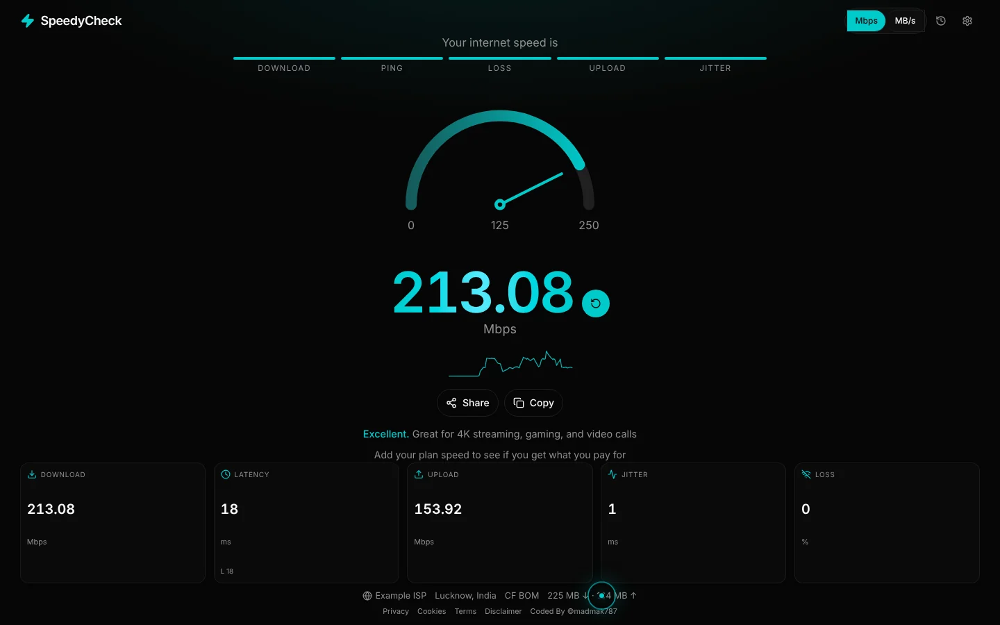

# SpeedyCheck

An internet speed test by [Mohd Amir Khan](https://khanamir.me). It measures download, upload, ping, jitter and packet loss against the nearest Cloudflare edge, straight from the browser. There is no backend and no account.

Live: **https://tool.khanamir.me/speedycheck**



## Features

- Download and upload measured with parallel transfers to `speed.cloudflare.com`, with a live speed graph and gauge
- Ping, jitter and packet loss from repeated small requests
- Results in Mbps or MB/s, with a plain-language verdict (for example, good enough for 4K streaming and video calls)
- Compare the result with the speed of your plan
- Test history saved in this browser, with a chart, side-by-side comparison and PDF export
- Share or save the result as an image card
- Installable as an app (PWA), plus privacy, cookie and terms pages

## Tech

Next.js (static export), React, TypeScript, Tailwind CSS and shadcn/ui.

## Run locally

```bash
npm install
npm run dev
```

Open [http://localhost:3000](http://localhost:3000). Locally the app runs at `/`; the `/speedycheck` base path is only applied in CI.

## Deploy

Pushing to `main` builds the static export and uploads it to Hostinger over FTPS (`.github/workflows/deploy.yml`).
